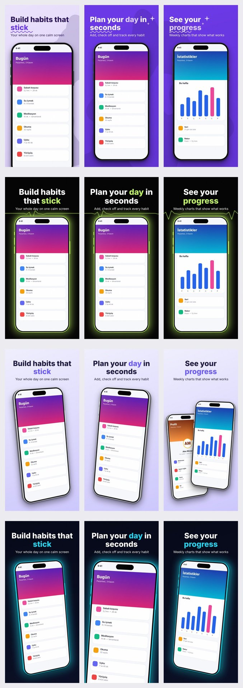

# shotforge

[](https://github.com/ibrahimatmaca/shotforge/actions/workflows/ci.yml)
[](LICENSE)


**App Store screenshots from your real app screens — decided and written by your own Claude.**
Give shotforge your screenshots; Claude looks at them and proposes the design (main colour, text/accent colour, number of pages,
**2D or 3D** template) and writes the headline copy in every language you want. You can fix any of those yourself, and whatever you
fix is kept exactly. The output is **one separate, upload-ready image per page per language** (1320×2868 for iPhone 6.9″) — never
one combined image.

*Türkçe okumak için: [README.tr.md](README.tr.md)*



## Features

- **Claude does the thinking, locally rendered.** Colours, page count, template and copy are decided by Claude from the screenshots;
  rendering is pure Python (Pillow + numpy). No design service, no account, no telemetry.
- **Three ways to bring your own Claude:** the `claude` CLI (Claude Code login), an Anthropic API key, or **MCP** (Claude Desktop,
  Claude Code, Cursor, …) where *your* chat Claude is the designer.
- **You stay in control.** Pass any of: main background colour, text colour, accent colour, page count, your own headlines
  (full or partial), 2D/3D, or a template. Everything you give is kept verbatim; Claude (or the built-in rules) fills the rest.
- **7 templates, 2D and 3D.** 2D = phone flat or rotated only in the plane; 3D = phone tilted in perspective with visible thickness.
  Automatic selection follows documented rules (`shotforge rules`) and never picks a template whose theme clashes with your colour.
- **Asks before it starts.** The slash command, MCP tools and terminal share one question list; anything left blank gets a default, with colours taken from your screenshots.
- **App Store and Google Play** from one run: phone and tablet sizes, App Store Header and Search Results images, and the Play feature graphic.
- **Multi-language in one run** (`--langs en,tr,de`): one folder per language plus a zip, optional per-language screenshots, **App Preview** video converter.
- **Brand file:** `shotforge.toml` keeps colours, font, logo and tone, so every run and every app looks the same.
- **Maestro capture:** `shotforge capture` runs your flows per language on a booted device and writes the screenshots shotforge reads.
- **Store tests:** `--variants 2` writes complete sets that differ by copy, design or both, ready for Custom Product Pages and Play experiments.
- **fastlane folders:** `--layout fastlane` writes the trees `deliver` and `supply` upload. shotforge itself uploads nothing.
- **ASO copy:** `--keywords` tells the AI which search terms to work into the headlines.
- **Readable by construction:** unreadable text colours are corrected per slide (contrast ≥ 3:1 for headlines) and reported.

## Install

Requires Python 3.10+.

```bash
# CLI
pipx install "git+https://github.com/ibrahimatmaca/shotforge@v0.5.0"
# CLI + MCP server
pipx install "shotforge[mcp] @ git+https://github.com/ibrahimatmaca/shotforge@v0.5.0"
# or run without installing (needs uv)
uvx --from "shotforge[mcp] @ git+https://github.com/ibrahimatmaca/shotforge@v0.5.0" shotforge-mcp

shotforge doctor     # checks Python deps, ffmpeg (optional), claude CLI / API keys
```

## Quick start (CLI)

```bash
# 1) Let Claude decide everything (uses your logged-in `claude` CLI, or ANTHROPIC_API_KEY)
shotforge create ./screens --app "Habita" --about "Habit tracker with weekly stats" --langs en,tr --no-ask -o out

#    Not using Claude? Add: --ai openai  (needs OPENAI_API_KEY and `pip install openai`)

# 2) Fix the choices you care about; Claude fills the rest
shotforge create ./screens --app "Habita" --dimension 3d --bg-color "#0B1026" --accent "#F472B6" --count 6 -o out

# 3) Write your own copy (partial is fine) — see "Your own text" below
shotforge create ./screens --app "Habita" --texts my-texts.txt -o out

# 4) Answer questions in the terminal (Enter = let Claude decide)
shotforge create ./screens --app "Habita" --ask
```

Result, as separate files per language:

```
out/
  en/
    app-store/
      iphone-6.9/01_home.png …
      header-search/5244x2950.png, 3840x2560.png, 1920x1280.png
      previews/iphone-6.9.mp4          # only if you pass --preview
    google-play/
      phone/01_home.png …
      feature-graphic/1024x500.png
  tr/ …
  manifest.json                        # every file, its size, the decisions and warnings
  habita.zip                           # en/, tr/, manifest.json
  shotforge.copy.json, _review/        # not in the zip
```

Without `-o`, output goes to `./shotforge-out/<app>/`. Add `--sheet` for a single side-by-side `_review/overview_<lang>.jpg`
(a review aid, not a deliverable) and `--brief` for a copy-paste prompt to recreate the set in Claude Design.

## What it asks, and the defaults

| Question | Flag | If left blank |
|---|---|---|
| Store | `--store appstore\|playstore\|both` | both |
| Header and Search Results images (App Store) | `--header-sizes 5244x2950,3840x2560,1920x1280\|no` | all three |
| Languages | `--langs en,tr,de` | en, tr |
| 2D, 3D or a template | `--dimension`, `--template` | chosen by the rules |
| Device sizes | `--devices iphone-6.9,ipad-13,android-phone,android-tablet-7,android-tablet-10` | iphone-6.9, android-phone |
| Pages | `--count` | 6–7 |
| Headlines and tone | `--texts`, `--tone` | written by Claude |
| Background, text, accent colour | `--bg-color`, `--text-color`, `--accent` | from the screenshots; template default if they are neutral |
| App icon for the wide images | `--icon` | none |
| App Preview recording, shared or per language | `--preview rec.mov`, `--preview tr=rec_tr.mov` | skipped |
| Output | `-o`, `--no-zip`, `--zip-only` | `./shotforge-out/<app>/` and a zip |

`--no-ask` skips the questions and uses these defaults. Passing `--device` draws that one device with the old `out/<lang>/` layout, no store folders or zip.

**Separate screenshots per language or platform:** put them in `<folder>/tr/`, `<folder>/android/`, `<folder>/android/tr/`, `<folder>/ipad/` or `<folder>/android-tablet/`, with the same file names. shotforge warns when it has to fall back, for example to an English UI on a Turkish page.

**Store notes:**
- Google Play takes up to 8 images per device type and at least 4 for tablets; extra pages are dropped with a warning.
- Google's guidance recommends against device imagery, taglines over 20% of the image, and words like "Best" or "Free". It is a recommendation, not a requirement for phones and tablets, but it can affect where the listing is featured, so shotforge warns on every Play run.
- Per third-party guides, 5244x2950 works for both the App Store header and search results (PNG only), while 3:2 sizes work for search results only. Check the crop in App Store Connect's preview; shotforge keeps text near the centre.
- App Preview needs ffmpeg and is App Store only; Google Play takes a YouTube link.

## Who decides what

| Decision | You fix it with | If you don't |
|---|---|---|
| Main background colour | `--bg-color #HEX` | Claude picks one from the app's look (local colour analysis as a hint) |
| Text colour | `--text-color #HEX` | automatic, readable on every slide |
| Accent colour | `--accent #HEX` | Claude / derived from the background |
| Number of pages | `--count N` (1–10) or the number of slides in `--texts` | Claude picks 6 or 7 |
| Copy | `--texts file` (full or partial) | Claude writes it, looking at each screenshot |
| 2D / 3D | `--dimension 2d\|3d` | rules / Claude decide |
| Template | `--template name` | rules / Claude decide |

If you fix everything, Claude is not called at all. If you fix a background colour, Claude's template choice is overridden when its
theme clashes with that colour (the reason is printed). Results are written to `shotforge.copy.json`; edit it and run
`shotforge render` to redraw without calling Claude again.

### Your own text

```text
# slide 1
shot: 01_home.png                         (optional)
en: Build habits that *stick* | Your whole day on one calm screen
tr: Kalıcı *alışkanlıklar* edin | Tüm günün tek sakin ekranda

# slide 2
tr: Gününü *planla*                       (missing 'en' -> Claude writes it)
```

`*word*` = accent colour · `| …` = subtitle · `\n` = line break. JSON works too. Example: [`examples/texts.example.txt`](examples/texts.example.txt).

## Templates: 2D vs 3D

| | Template | Theme | Suits |
|---|---|---|---|
| 2D | `bubble` | colorful | education, lifestyle, productivity, health |
| 2D | `heartbeat` | dark | fitness, health, finance, utilities |
| 2D | `halo` | dark | health, fitness, productivity, utilities |
| 2D | `slant` | dark | social, entertainment, productivity |
| 3D | `classic` | colorful | entertainment, lifestyle, travel, shopping, social, photo |
| 3D | `prism3d` | light | lifestyle, shopping, travel, photo, education, social |
| 3D | `neon3d` | dark | games, entertainment, photo, fitness, social |

Automatic choice (`--template auto`, see `shotforge rules`; try `shotforge analyze ./screens --category health`):
**3D score** = +2 for games/photo/travel/shopping/entertainment/lifestyle, −2 for finance/productivity/utilities/health (−1 fitness/education),
+1 for ≤ 3 distinct screenshots, −2 for dense small-text UIs, +1 for a premium/playful/creative tone → 3D when ≥ 1, else 2D.
Inside the family: +3 theme match (dark colour → dark template, very light → light, vivid mid-tone → colorful), +3 category match.
`--template` disables the auto choice; `--dimension` restricts it.

Per-slide layouts, colours and decorations come from `shotforge/templates/*.json` (`palette`, `bg_mode`, `layouts`, `defaults` with
`$bg`/`$accent`/`$text` placeholders). Copy one, edit it, and pass `--template my.json`.

## Use it from your own Claude via MCP

`shotforge-mcp` is a stdio MCP server. In MCP mode **your chat Claude is the designer**: it looks at the screenshots, asks you
what you want to fix, writes the copy, and calls the tools; shotforge renders and returns an overview image so Claude can check
its own work. No API key is needed.

```bash
# Claude Code
claude mcp add shotforge -- shotforge-mcp
#   (without installing:  claude mcp add shotforge -- uvx --from "shotforge[mcp] @ git+https://github.com/ibrahimatmaca/shotforge@v0.5.0" shotforge-mcp)
```

Claude Desktop / Cursor / any MCP client (`claude_desktop_config.json` or the client's MCP settings):

```json
{
  "mcpServers": {
    "shotforge": {
      "command": "uvx",
      "args": ["--from", "shotforge[mcp] @ git+https://github.com/ibrahimatmaca/shotforge@v0.5.0", "shotforge-mcp"]
    }
  }
}
```

(If you installed with pipx, use `"command": "shotforge-mcp"` and no args.)

| Tool | Purpose |
|---|---|
| `analyze_screenshots` | local colour/theme/density analysis + rule-based 2D/3D recommendation + rules and template catalogue |
| `list_templates` | templates with dimension, theme and suited categories |
| `create_screenshots` | takes Claude's/your decisions (`slides`, colours, template/dimension, `langs`, `count`, `only`, `layout`, …) and writes separate images; returns paths + overview image |
| `render_screenshots` | redraw from `shotforge.copy.json` after edits, optionally with another template/colours |
| `convert_app_preview` | screen recording → App Store app-preview spec (ffmpeg) |

A prompt named `store_screenshots` walks Claude through the whole flow. Then just say:
*"Make App Store screenshots from ~/Desktop/habita-screens for my app Habita, English and Turkish, 3D."*
Output goes to `~/shotforge-out` by default.

## Claude Code slash command

```bash
shotforge install-claude --global      # writes ~/.claude/commands/store-shots.md
```

`/store-shots ./screens "Habita" "habit tracker"` asks you the questions above before starting, runs `shotforge create`, opens
the overview images and fixes problems it finds.

## Brand file

Put `shotforge.toml` in your project (see [`examples/shotforge.toml`](examples/shotforge.toml)). `create`, `plan` and `render` find it in the current folder
or a parent, up to the repository root; `--brand FILE` picks another one and `--no-brand` ignores it. Flags win over the file, and the file wins over the AI.

```toml
[brand]
tone = "calm, direct, benefit-first"
template = "bubble"
langs = ["en", "tr"]
font = "assets/Brand-Bold.otf"     # relative to this file, must stay inside its folder
logo = "assets/logo.png"           # small, in the free band beside the headline; header icon unless --icon is given

[brand.colors]
background = "#6D28D9"
text = "#FFFFFF"
accent = "#FDE047"
```

`render` keeps the design in the copy file and takes only `font` and `logo` from the brand file. To restyle hand-edited colours, use the render flags.

## Keywords

```bash
shotforge create ./screens --app Habita --keywords "habit tracker,daily routine"
```

The AI works the terms in where they read naturally and within the length limits, and shotforge lists any not found word for word (a localized term can be the reason).
Offline mode writes placeholder copy and can't use them. Apple doesn't document screenshot text as a search ranking factor, so keep filling the App Store keyword field;
treat this as matching your headlines to what people searched for. Google Play's guidelines advise against words like "Best", "#1" and "Free" in images, and shotforge warns about them.

## Store test variants

```bash
shotforge create ./screens --app Habita --variants 3 --variant-by both -o out
# out/variant-a/, out/variant-b/, out/variant-c/  — each with its own copy file, manifest, zip and images
```

`--variant-by copy` keeps the design of variant A and gives each variant another messaging angle. `design` keeps A's text and colours, uses another template, and tries the other of 2D/3D for B unless
you set `--dimension`; no further AI call is made. `both` (default) changes both. `--template` sets variant A only. Different copy needs an AI backend: offline runs warn that the headlines are the same.
Design questions are not asked with `--variants`, so pass choices as flags. Upload each folder as its own Custom Product Page or Play experiment.

## Maestro capture

shotforge doesn't know your app's screens. **Your Maestro flow decides which pages are captured:** every `takeScreenshot` is one page, and the flow taps its way there. shotforge runs that flow per language and collects the PNGs. It doesn't boot a device, install the app or change the device language.

**1. Install Maestro and your app.** Install [Maestro](https://docs.maestro.dev), then install a build of your app on a simulator or emulator. `shotforge doctor` shows whether Maestro and a booted device are found.

**2. Choose the pages.** Pick the 6–8 screens that sell the app, in the order you want to show them. Google Play takes at most 8 images per device type, and the App Store at most 10.

**3. Find what to tap.** Use Maestro Studio (right-click an element on the device) or `maestro hierarchy` in a terminal. Prefer `id` over visible text, because text changes with the language. An id may need adding to your app, such as `accessibilityIdentifier` on iOS.

**4. Write one flow** in its own folder, so your normal test runs don't pick it up:

```yaml
# .maestro/shots/store.yaml
appId: com.example.habita
---
- launchApp:
    clearState: true
    permissions:
      all: allow
- runFlow: login.yaml            # if the screens need an account; use a test account
- extendedWaitUntil:
    visible:
      id: "home_list"
    timeout: 15000
- takeScreenshot: 01_home

- tapOn:
    id: "tab_stats"
- waitForAnimationToEnd
- takeScreenshot: 02_stats

- tapOn:
    id: "tab_goals"
- waitForAnimationToEnd
- takeScreenshot: 03_goals
```

- Number the names: the number sets the page order. Use the same names in every language, because shotforge matches screens by file name.
- Keep the pages in one file. Maestro runs the flows in a folder in no fixed order and ignores subfolders.
- `clearState` signs the app out, so the flow has to log in again, or remove `clearState`.
- Use test data with realistic content. The screens are published as they are.
- For iPhone and iPad, or for iOS and Android, write separate flows if the navigation differs, and capture with `--platform ios`, `ipad`, `android` or `android-tablet`.

**5. Capture in each language.** Maestro sets the language on the device, not in the flow, so use one of these:

*A. One device per language (works without changing your app).* Start each device, install the app on it if it's new, and capture that language. Keep one device running at a time, or pass `--device <id>`:

```bash
maestro start-device --platform ios --device-locale en_US
shotforge capture --flows .maestro/shots/store.yaml --langs en --platform ios -o shots

maestro start-device --platform ios --device-locale tr_TR
shotforge capture --flows .maestro/shots/store.yaml --langs tr --platform ios -o shots
```

*B. Your app reads the language at launch (one device, one command).* shotforge passes each language to the flow as `${LANG}`. Send it as a launch argument, and have a debug build of your app read it (`UserDefaults` on iOS, intent extras on Android) and switch language:

```yaml
- launchApp:
    arguments:
      appLanguage: ${LANG}
```

```bash
shotforge capture --flows .maestro/shots/store.yaml --langs en,tr --platform ios -o shots
```

**6. Check the screenshots.** Open `shots/ios/tr/` and confirm the UI really is in Turkish: a language that didn't switch still produces images, with no error. shotforge warns about missing names (within one run), about shapes that would be cropped, and about older PNGs in the folder, which it leaves in place and which would become slides.

**7. Create the images:**

```bash
shotforge create shots --app Habita --langs en,tr
```

With option B you can do steps 5 and 7 in one command: `shotforge create shots --maestro .maestro/shots/store.yaml --capture-platform ios --app Habita --langs en,tr`.

## fastlane

```bash
shotforge create ./screens --app Habita --layout fastlane -o store
fastlane deliver --screenshots_path store/fastlane/screenshots --skip_binary_upload --skip_metadata --overwrite_screenshots
fastlane supply --metadata_path store/fastlane/metadata/android --skip_upload_apk --skip_upload_aab --skip_upload_metadata --skip_upload_changelogs
```

```
store/fastlane/screenshots/en-US/APP_IPHONE_67_iphone-6.9_01_home.png        # deliver finds the device from the image size
store/fastlane/metadata/android/en-US/images/phoneScreenshots/01_home.png    # also sevenInchScreenshots, tenInchScreenshots
store/fastlane/metadata/android/en-US/images/featureGraphic.png
store/app-store-extra/en/header-search/5244x2950.png                         # deliver doesn't upload these
store/en/app-store/previews/iphone-6.9.mp4                                   # App Previews, if any: upload these yourself
```

Language codes become store locales (`en → en-US`, `tr → tr` on Apple and `tr-TR` on Play). Check a new device size against your fastlane version; both tools change with the stores.

## App Store Connect

```bash
shotforge create ./screens --app Habita --store appstore --header-sizes no --layout asc -o media
# media/en-US/APP_IPHONE_67/01_home.png, media/tr/APP_IPHONE_67/…  — works with folder-based uploaders such as
#   asc apps media upload com.example.MyApp --folder media/ --replace      (keremerkan/asc-cli)
shotforge preview recording.mov -o preview.mp4      # 886x1920, 30 fps, H.264/AAC, ≤ 30 s (needs ffmpeg)
```

`--layout asc` folder names: `iphone-6.9 → APP_IPHONE_67`, `iphone-6.5 → APP_IPHONE_65`, `ipad-13 → APP_IPAD_PRO_3GEN_129`;
`en → en-US`. Check them against your uploader's docs — Apple changes these identifiers over time. `shotforge sizes` prints the sizes.
App previews are plain screen recordings (no frame added).

## Backends, privacy and cost

| `--ai` | What runs |
|---|---|
| `auto` | `claude` CLI if found, else `ANTHROPIC_API_KEY` (needs `pip install anthropic`), else offline |
| `claude` | `claude -p --output-format json --tools Read --allowedTools Read --strict-mcp-config --add-dir <screens>` (prompt on stdin) — your Claude Code login |
| `api` | Anthropic API with your key (`--model` to choose) |
| `openai` | OpenAI Responses API with `OPENAI_API_KEY` (needs `pip install openai`). Default model `gpt-6.1-sol`, `--model` to choose. Only runs when you ask for it: `auto` never picks it |
| `offline` | no AI: local rules decide design, placeholder copy |

Screenshots leave your machine only toward the AI you configured (your Claude Code account, your Anthropic or OpenAI API key, or your MCP host) —
shotforge itself has no server and no telemetry. The OpenAI backend sends `store: false`, so responses are not kept for later retrieval; your
OpenAI account's data terms still apply. Usage counts against *your* plan or API billing. The model's answer is validated
(page count, file names, template name, hex colours, empty titles) and retried once; remaining problems are repaired by the rules.

## Status and known limitations

Beta (v0.5). CI runs the test-suite on Linux with Python 3.10–3.14 and on macOS with Python 3.13.

- The `claude -p` path is covered by tests against a fake `claude` executable that mimics Claude Code's JSON envelope; please report
  anything that differs with your real installation. The MCP server was exercised with the official MCP client on `mcp` 1.30 and 2.3.
- Linux/macOS are tested; Windows is untested.
- Device frames are generic modern-phone drawings, not Apple's official bezels. ~5–6 s per image.
- Headlines: ≤ 3 lines, subtitles ≤ 2 lines; long text shrinks automatically, and text that still overflows is reported. The bundled Inter font has no Japanese, Korean or Arabic glyphs: shotforge warns, and `--font` selects another font (Arabic also needs Pillow with raqm). Screenshot analysis is a simple heuristic (a hint, not a verdict).
- Tablet output crops a phone screenshot to the tablet ratio; supply real tablet screens. Android output reuses iOS screens unless you supply `android/`.
- Arabic and Hebrew are not laid out right to left. The App Store header-only 3840x1646 size is not generated.

## Development

```bash
git clone https://github.com/ibrahimatmaca/shotforge && cd shotforge
python -m venv .venv && . .venv/bin/activate
pip install -e ".[dev]"
pytest -q
```

See [CONTRIBUTING.md](CONTRIBUTING.md).

## Credits and disclaimer

- Bundled font: [Inter](https://github.com/rsms/inter) (SIL Open Font License 1.1, see `shotforge/fonts/LICENSE-Inter.txt`).
- Template art direction was inspired by publicly viewable template galleries such as AppScreens'. shotforge is an independent project and is
  **not affiliated with or endorsed by AppScreens, Apple or Anthropic**. All templates are original code; no third-party assets are included.
  "App Store" and "iPhone" are trademarks of Apple Inc.; "Claude" is a trademark of Anthropic.

## License

[MIT](LICENSE)
