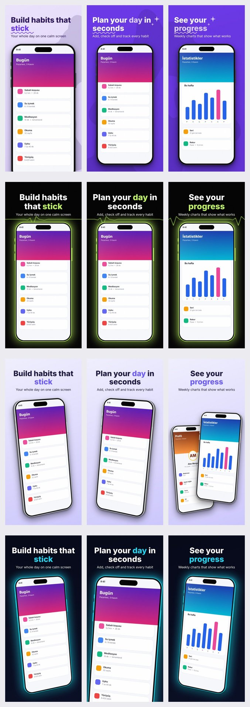

# shotforge

[](https://github.com/ibrahimatmaca/shotforge/actions/workflows/ci.yml)
[](LICENSE)

**Gerçek uygulama ekranlarınızdan App Store görselleri — kararları ve metinleri sizin kendi Claude'unuz hazırlar.**
Ekran görüntülerinizi verirsiniz; Claude bakıp tasarımı önerir (ana renk, yazı/vurgu rengi, sayfa sayısı, **2D veya 3D** şablon) ve istediğiniz
her dilde başlık metinlerini yazar. Bunların herhangi birini siz de belirleyebilirsiniz; belirlediğiniz her şey olduğu gibi korunur.
Çıktı: her sayfa için, her dilde **AYRI ve yüklemeye hazır bir görsel dosyası** (iPhone 6.9″ için 1320×2868) — asla tek birleşik görsel değil.

*English: [README.md](README.md)*



## Özellikler

- **Karar Claude'dan, çizim yerelde.** Renkler, sayfa sayısı, şablon ve metinleri Claude ekranlara bakarak belirler; render saf Python'dur
  (Pillow + numpy). Tasarım servisi, hesap veya telemetri yok.
- **Kendi Claude'unuzu getirmenin üç yolu:** `claude` CLI (Claude Code girişiniz), Anthropic API anahtarı veya **MCP** (Claude Desktop,
  Claude Code, Cursor …): sohbetteki Claude tasarımcı olur.
- **Kontrol sizde.** Ana arka plan, yazı ve vurgu rengi, sayfa sayısı, kendi başlık metinleriniz (tam ya da kısmi), 2D/3D veya şablon:
  vereceğiniz her şey aynen korunur, kalanı Claude (veya yerleşik kurallar) tamamlar.
- **2D ve 3D olmak üzere 7 şablon.** 2D = telefon düz ya da yalnızca düzlem içinde döndürülmüş; 3D = perspektifli, kalınlığı görünen eğik telefon.
  Otomatik seçim belgelenmiş kurallara göredir (`shotforge rules`); verdiğiniz renkle teması çelişen şablon seçilmez.
- **Başlamadan sorar.** Slash komutu, MCP araçları ve terminal aynı soru listesini kullanır; boş bırakılan alan varsayılan alır, renkler ekran görüntülerinizden gelir.
- Tek çalıştırmada **App Store ve Google Play**: telefon ve tablet boyutları, App Store Header and Search Results görselleri, Play feature graphic.
- Tek komutta **çok dilli** çıktı (`--langs en,tr,de`): her dile bir klasör ve zip, isteğe bağlı dile özel ekran görüntüleri, **App Preview** video dönüştürücü.
- **Okunaklılık:** okunaksız yazı rengi slayt başına düzeltilir (başlıklar için kontrast ≥ 3:1) ve raporlanır.

## Kurulum

Python 3.10+ gerekir.

```bash
# CLI
pipx install "git+https://github.com/ibrahimatmaca/shotforge"
# CLI + MCP sunucusu
pipx install "shotforge[mcp] @ git+https://github.com/ibrahimatmaca/shotforge"
# kurmadan çalıştırma (uv gerekir)
uvx --from "shotforge[mcp] @ git+https://github.com/ibrahimatmaca/shotforge" shotforge-mcp

shotforge doctor     # Python bağımlılıkları, ffmpeg (isteğe bağlı), claude CLI / API anahtarı kontrolü
```

## Hızlı başlangıç (CLI)

```bash
# 1) Her şeyi Claude belirlesin (giriş yapmış `claude` CLI'nizi veya ANTHROPIC_API_KEY'i kullanır)
shotforge create ./ekranlar --app "Habita" --about "Haftalık istatistikli alışkanlık takibi" --langs en,tr --no-ask -o out

# 2) Önemsediğiniz kararları siz verin, kalanını Claude tamamlasın
shotforge create ./ekranlar --app "Habita" --dimension 3d --bg-color "#0B1026" --accent "#F472B6" --count 6 -o out

# 3) Kendi metinleriniz (kısmi olabilir) — aşağıdaki "Kendi metniniz" bölümüne bakın
shotforge create ./ekranlar --app "Habita" --texts metinlerim.txt -o out

# 4) Terminalde soruları yanıtlayın (Enter = Claude karar versin)
shotforge create ./ekranlar --app "Habita" --ask
```

Sonuç, her dil için ayrı dosyalar:

```
out/
  en/
    app-store/
      iphone-6.9/01_home.png …
      header-search/5244x2950.png, 3840x2560.png, 1920x1280.png
      previews/iphone-6.9.mp4          # yalnızca --preview verilirse
    google-play/
      phone/01_home.png …
      feature-graphic/1024x500.png
  tr/ …
  manifest.json                        # tüm dosyalar, boyutlar, kararlar ve uyarılar
  habita.zip                           # en/, tr/, manifest.json
  shotforge.copy.json, _review/        # zip'e girmez
```

`-o` verilmezse çıktı `./shotforge-out/<uygulama>/` altına yazılır. `--sheet`, yan yana tek bir kontrol görseli yazar
(`_review/overview_<dil>.jpg`; teslim dosyası değildir); `--brief`, aynı seti Claude Design'da yapmak için hazır bir istem yazar.

## Sorulan sorular ve varsayılanlar

| Soru | Seçenek | Boş bırakılırsa |
|---|---|---|
| Mağaza | `--store appstore\|playstore\|both` | ikisi |
| Header and Search Results görselleri (App Store) | `--header-sizes 5244x2950,3840x2560,1920x1280\|no` | üçü de |
| Diller | `--langs en,tr,de` | en, tr |
| 2D, 3D veya şablon | `--dimension`, `--template` | kurallar seçer |
| Cihaz boyutları | `--devices iphone-6.9,ipad-13,android-phone,android-tablet-7,android-tablet-10` | iphone-6.9, android-phone |
| Sayfa sayısı | `--count` | 6–7 |
| Başlıklar ve ton | `--texts`, `--tone` | Claude yazar |
| Arka plan, yazı, vurgu rengi | `--bg-color`, `--text-color`, `--accent` | ekran görüntülerinden; nötrlerse şablon varsayılanı |
| Yatay görseller için uygulama ikonu | `--icon` | yok |
| App Preview kaydı, ortak veya dil başına | `--preview kayit.mov`, `--preview tr=kayit_tr.mov` | atlanır |
| Çıktı | `-o`, `--no-zip`, `--zip-only` | `./shotforge-out/<uygulama>/` ve zip |

`--no-ask` soruları atlar ve bu varsayılanları kullanır. `--device` verilirse yalnızca o cihaz eski `out/<dil>/` düzeniyle çizilir; mağaza klasörü ve zip olmaz.

**Dile veya platforma göre ayrı ekran görüntüleri:** aynı dosya adlarıyla `<klasör>/tr/`, `<klasör>/android/`, `<klasör>/android/tr/`, `<klasör>/ipad/` veya `<klasör>/android-tablet/` altına koyun. Örneğin Türkçe sayfada İngilizce arayüz kullanılmak zorunda kalırsa shotforge uyarır.

**Mağaza notları:**
- Google Play cihaz türü başına en fazla 8 görsel, tablet için en az 4 görsel ister; fazla sayfalar uyarıyla çıkarılır.
- Google'ın yönergesi cihaz görseli, görselin %20'sini aşan slogan ve "Best", "Free" gibi sözleri önermez. Bu, telefon ve tablet için zorunlu kural değil, ama öne çıkarılmayı etkileyebilir; bu yüzden her Play çalıştırmasında uyarı verilir.
- Üçüncü taraf rehberlere göre 5244x2950 hem App Store başlığında hem aramada çalışır (yalnızca PNG), 3:2 boyutlar yalnızca aramada çalışır. Kırpmayı App Store Connect önizlemesinde kontrol edin; shotforge metni ortaya yakın tutar.
- App Preview için ffmpeg gerekir ve yalnızca App Store içindir; Google Play YouTube bağlantısı alır.

## Kim neye karar verir?

| Karar | Siz verirseniz | Vermezseniz |
|---|---|---|
| Ana arka plan rengi | `--bg-color #HEX` | Claude uygulamanın görünümünden seçer (yerel renk analizi ipucu) |
| Yazı rengi | `--text-color #HEX` | otomatik, her slaytta okunaklı |
| Vurgu rengi | `--accent #HEX` | Claude / arka plandan türetilir |
| Sayfa sayısı | `--count N` (1–10) veya `--texts` içindeki slayt sayısı | Claude 6 veya 7 seçer |
| Metinler | `--texts dosya` (tam/kısmi) | Claude her ekrana bakarak yazar |
| 2D / 3D | `--dimension 2d\|3d` | kurallar / Claude |
| Şablon | `--template ad` | kurallar / Claude |

Her şeyi siz verirseniz Claude hiç çağrılmaz. Arka plan rengi verdiyseniz ve Claude'un şablonu o renkle çelişiyorsa şablon değiştirilir (gerekçe yazılır).
Sonuçlar `shotforge.copy.json` dosyasına yazılır; düzenleyip `shotforge render` ile Claude'u tekrar çağırmadan yeniden çizebilirsiniz.

### Kendi metniniz

```text
# slayt 1
shot: 01_home.png                         (isteğe bağlı)
en: Build habits that *stick* | Your whole day on one calm screen
tr: Kalıcı *alışkanlıklar* edin | Tüm günün tek sakin ekranda

# slayt 2
tr: Gününü *planla*                       (en eksik -> Claude yazar)
```

`*kelime*` = vurgu rengi · `| …` = alt başlık · `\n` = satır sonu. JSON da olur. Örnek: [`examples/texts.example.txt`](examples/texts.example.txt).

## Şablonlar: 2D ve 3D

| | Şablon | Tema | Uygun |
|---|---|---|---|
| 2D | `bubble` | colorful | education, lifestyle, productivity, health |
| 2D | `heartbeat` | dark | fitness, health, finance, utilities |
| 2D | `halo` | dark | health, fitness, productivity, utilities |
| 2D | `slant` | dark | social, entertainment, productivity |
| 3D | `classic` | colorful | entertainment, lifestyle, travel, shopping, social, photo |
| 3D | `prism3d` | light | lifestyle, shopping, travel, photo, education, social |
| 3D | `neon3d` | dark | games, entertainment, photo, fitness, social |

Otomatik seçim (`--template auto`; `shotforge rules`, `shotforge analyze ./ekranlar --category health`):
**3D puanı** = games/photo/travel/shopping/entertainment/lifestyle +2; finance/productivity/utilities/health −2 (fitness/education −1);
en çok 3 farklı ekran +1; yoğun küçük yazılı arayüz −2; premium/playful/creative ton +1 → puan ≥ 1 ise 3D, değilse 2D.
Aile içinde: tema uyumu +3 (koyu renk → dark, çok açık → light, canlı orta ton → colorful), kategori uyumu +3.
`--template` otomatik seçimi kapatır, `--dimension` sınırlar. Kendi şablonunuz için `shotforge/templates/*.json` dosyalarından birini kopyalayıp `--template benim.json` verin.

## MCP ile kendi Claude'unuzdan kullanın

`shotforge-mcp` bir stdio MCP sunucusudur. MCP modunda **sohbetteki Claude tasarımcıdır**: ekranlara bakar, neyi belirlemek istediğinizi sorar,
metinleri yazar ve araçları çağırır; shotforge çizer ve Claude'un kendi işini kontrol edebilmesi için önizleme görseli döndürür. API anahtarı gerekmez.

```bash
# Claude Code
claude mcp add shotforge -- shotforge-mcp
#   (kurmadan:  claude mcp add shotforge -- uvx --from "shotforge[mcp] @ git+https://github.com/ibrahimatmaca/shotforge" shotforge-mcp)
```

Claude Desktop / Cursor / diğer MCP istemcileri:

```json
{
  "mcpServers": {
    "shotforge": {
      "command": "uvx",
      "args": ["--from", "shotforge[mcp] @ git+https://github.com/ibrahimatmaca/shotforge", "shotforge-mcp"]
    }
  }
}
```

(pipx ile kurduysanız `"command": "shotforge-mcp"` ve `args` yok.)

Araçlar: `analyze_screenshots`, `list_templates`, `create_screenshots` (ayrı görselleri yazar; yollar + önizleme döner), `render_screenshots`
(`shotforge.copy.json`'dan yeniden çizer), `convert_app_preview`. `store_screenshots` adlı prompt tüm akışı Claude'a anlatır. Sonra şunu söylemeniz yeter:
*"~/Desktop/habita-screens içindeki ekranlardan Habita uygulamam için İngilizce ve Türkçe, 3D App Store görselleri yap."* Çıktı varsayılan olarak `~/shotforge-out` içine gider.

## Claude Code slash komutu

```bash
shotforge install-claude --global      # ~/.claude/commands/store-shots.md
```

`/store-shots ./ekranlar "Habita" "alışkanlık takibi"`: yukarıdaki soruları başlamadan sorar, `shotforge create`'i çalıştırır, önizlemeleri açıp sorunları düzeltir.

## App Store Connect

```bash
shotforge create ./ekranlar --app Habita --store appstore --header-sizes no --layout asc -o media
# media/en-US/APP_IPHONE_67/01_home.png, media/tr/APP_IPHONE_67/…   (klasör tabanlı yükleyicilerle:  asc apps media upload … --folder media/)
shotforge preview kayit.mov -o preview.mp4      # 886x1920, 30 fps, H.264/AAC, ≤ 30 sn (ffmpeg gerekir)
```

`--layout asc` klasör adlarını (`APP_IPHONE_67` vb.) yükleyicinizin belgesiyle karşılaştırın; Apple zamanla bu adları değiştirir. App Preview ham ekran kaydıdır, çerçeve eklenmez.

## Backend'ler, gizlilik ve maliyet

`--ai auto|claude|api|offline`: `claude` CLI varsa o (`claude -p … --allowedTools Read`), yoksa `ANTHROPIC_API_KEY`, yoksa offline (yerel kurallar + yer tutucu metin).
Ekran görüntüleriniz yalnızca yapılandırdığınız Claude'a gider (Claude Code hesabınız, API anahtarınız veya MCP istemciniz); shotforge'un sunucusu ve telemetrisi yoktur.
Kullanım *sizin* planınızdan/API faturanızdan düşer. Claude'un çıktısı doğrulanır ve bir kez yeniden denenir; kalan sorunlar kurallarla düzeltilir.

## Durum ve bilinen sınırlar

Beta (v0.4). CI, testleri Linux ve macOS'ta Python 3.10–3.13 ile çalıştırır.

- `claude -p` yolu, Claude Code'un JSON zarfını taklit eden sahte bir `claude` ile test edilir; gerçek kurulumunuzda farklı bir şey görürseniz lütfen bildirin.
  MCP sunucusu resmi MCP istemcisiyle `mcp` 1.30 ve 2.3 üzerinde denendi.
- CLI mesajları ve `--help` şu an **Türkçe**; README ve MCP araç açıklamaları İngilizce. İngilizce arayüz sıradaki iyileştirme — katkıya açığız.
- Linux/macOS test edilir; Windows denenmedi.
- Çerçeve genel bir modern telefon çizimidir (Apple'ın resmi bezel'i değil). Görsel başına ~5–6 sn.
- Başlık ≤ 3, alt başlık ≤ 2 satır; uzun metin otomatik küçülür. Ekran analizi basit bir sezgidir (ipucu, hüküm değil).
- Tablet çıktısında telefon ekranı verirseniz tablet oranına kırpılır; gerçek tablet ekranı verin. `android/` vermezseniz Android çıktısı iOS ekranlarını kullanır.
- Arapça ve İbranice sağdan sola dizilmez. App Store'un yalnızca başlıkta kullanılan 3840x1646 boyutu üretilmez.

## Geliştirme

```bash
git clone https://github.com/ibrahimatmaca/shotforge && cd shotforge
python -m venv .venv && . .venv/bin/activate
pip install -e ".[dev]"
pytest -q
```

## Kaynaklar ve uyarı

- Yazı tipi: [Inter](https://github.com/rsms/inter) (SIL Open Font License 1.1).
- Şablonların sanat yönü, AppScreens gibi herkese açık şablon galerilerinden esinlendi. shotforge bağımsız bir projedir;
  **AppScreens, Apple veya Anthropic ile bağlantılı değildir ve onlarca onaylanmamıştır.** Şablonlar özgün koddur, üçüncü taraf varlık içermez.
  "App Store" ve "iPhone" Apple Inc. markalarıdır; "Claude" Anthropic markasıdır.

## Lisans

[MIT](LICENSE)
